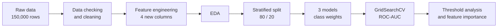
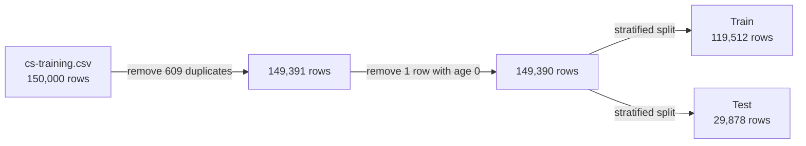

<div align="center">

# Credit Scoring Model
**Predicting serious loan delinquency with Logistic Regression, Decision Tree and Random Forest**

**CodeAlpha Machine Learning Internship, Task 1**

[](https://www.python.org/)
[](https://scikit-learn.org/)
[](https://pandas.pydata.org/)
[](https://jupyter.org/)
[](https://www.kaggle.com/datasets/brycecf/give-me-some-credit-dataset?select=cs-training.csv)

</div>

---

## Overview

Before approving a loan, a bank wants to know whether the borrower is likely to fall seriously
behind on payments. This project predicts whether a borrower will be **90+ days late on a payment
within the next 2 years**, using the *Give Me Some Credit* dataset (150,000 borrowers).

Only **6.7% of borrowers default**, so a model that approves everyone would be 93% accurate and
catch nobody. For this reason the models are judged by **recall** (how many defaulters are caught)
and **ROC-AUC** (how well risk is ranked), not by accuracy.

The work follows one notebook from raw data to a tuned model:



### Key results

| Aspect | Result |
|---|---|
| Dataset | [Give Me Some Credit](https://www.kaggle.com/datasets/brycecf/give-me-some-credit-dataset?select=cs-training.csv) (Kaggle), 150,000 borrowers, 149,390 after cleaning, 6.7% defaulters |
| Best model | Tuned Random Forest — ROC-AUC **0.864**, recall **0.773**, precision 0.224, F1 0.348 |
| Logistic Regression | ROC-AUC 0.827, recall 0.637 |
| Overfitting fix | Decision Tree ROC-AUC **0.606 → 0.855** after limiting its depth |
| Hidden signal | Placeholder values (96/98) in the late-payment columns mark a group with **60.4%** default rate vs 6.6% for everyone else |
| Strongest predictors | Credit utilization and `total_late` (about 60% of the Random Forest's importance together) |
| Test set outcome | 1,547 of 2,002 defaulters caught, 455 missed, 5,351 good customers flagged as risky |

---

## Table of contents

1. [Dataset](#1-dataset)
2. [Notebook](#2-notebook)
3. [Data checking and cleaning](#3-data-checking-and-cleaning)
4. [Feature engineering](#4-feature-engineering)
5. [Exploratory analysis](#5-exploratory-analysis)
6. [Models and results](#6-models-and-results)
7. [Feature importance](#7-feature-importance)
8. [Reproducing the results](#8-reproducing-the-results)
9. [Limitations](#9-limitations)
10. [Repository structure](#10-repository-structure)
11. [References](#11-references)

---

## 1. Dataset

One public dataset was used. No new dataset was created, and the CSV is not stored in this
repository (see [`data/README.md`](data/README.md)).

| Property | Value |
|---|---|
| Source | [Give Me Some Credit, Kaggle](https://www.kaggle.com/datasets/brycecf/give-me-some-credit-dataset?select=cs-training.csv), file `cs-training.csv` |
| Size | 150,000 rows, 12 columns (one is an unnamed row index that is dropped) |
| Target | `SeriousDlqin2yrs` (1 = was 90+ days late within 2 years) |
| Class balance | 6.7% defaulters, about 1 defaulter for every 14 non-defaulters |
| Missing values | `MonthlyIncome` 29,731 (19.8%), `NumberOfDependents` 3,924 (2.6%) |

| Feature | Meaning |
|---|---|
| `RevolvingUtilizationOfUnsecuredLines` | Credit card balance divided by credit limit (normally 0 to 1) |
| `age` | Age of the borrower |
| `NumberOfTime30-59DaysPastDueNotWorse` | Times 30-59 days late |
| `NumberOfTime60-89DaysPastDueNotWorse` | Times 60-89 days late |
| `NumberOfTimes90DaysLate` | Times 90+ days late |
| `DebtRatio` | Monthly debt payments divided by monthly income |
| `MonthlyIncome` | Monthly income |
| `NumberOfOpenCreditLinesAndLoans` | Open loans and credit cards |
| `NumberRealEstateLoansOrLines` | Mortgage and property loans |
| `NumberOfDependents` | People who depend on the borrower's income |



---

## 2. Notebook

The whole analysis is in one notebook, [`notebooks/credit_scoring.ipynb`](notebooks/credit_scoring.ipynb),
written and run locally with Python 3.11.9.

| Section | What it does |
|---|---|
| Problem | States the task and why catching defaulters matters more than accuracy |
| Data Loading & Understanding | Loads the CSV, reads `info()` and `describe()`, lists what each column means |
| Data Checking | Missing values, duplicates, age, the 96/98 values, other suspicious values, why DebtRatio is so large |
| Data Cleaning | Applies one decision for each problem found |
| Feature Engineering | Creates `total_late` and `over_limit` (the other two new columns are created during cleaning) |
| Exploratory Data Analysis | Graphs that answer specific questions about default risk |
| Models Part | Train-test split, scaling, Logistic Regression, Decision Tree, Random Forest |
| Compare Table Result | The three models side by side, before tuning |
| Grid Part | `GridSearchCV` for each model, results before and after tuning |
| Changing the Threshold | Precision and recall at thresholds 0.3, 0.5 and 0.7 |
| Feature Importance | What the tuned Random Forest relies on |
| Conclusion | What was learned, limitations |

---

## 3. Data checking and cleaning

Every cleaning step is based on something found in `describe()` or in a follow-up check.

| Check | Rows |
|---|---:|
| `age < 18` | 1 |
| Late count is 96 or 98 | 269 |
| Credit utilization above 1 | 3,321 |
| Credit utilization above 10 | 241 |
| `DebtRatio` above 1 | 35,137 |
| `MonthlyIncome` equal to 0 | 1,634 |

| Problem found | Evidence | Decision |
|---|---|---|
| 609 duplicate rows | 510 of them have no income, so they are mostly records with little information that happen to match | Removed (0.4% of the data) |
| Age = 0 | 1 row, impossible for a borrower | Removed |
| Late counts of 96 and 98 | Counts run 0, 1, 2 ... 13 (up to 17 in one column), then jump straight to 96 and 98. Being late 98 times in 2 years is impossible | Saved as a flag, then replaced with 0 |
| Missing `MonthlyIncome` | 19.8% of rows, too many to delete | Flag column, then filled with the median |
| Missing `NumberOfDependents` | 2.6% of rows, all of them also missing income | Filled with the median |
| Very large `DebtRatio` | Median is 0.30 when income is present but 1,159 when income is missing, so the raw debt amount was stored instead of a ratio | `income_missing` flag lets the model tell these rows apart |

### The 96/98 values are not noise

In the raw data, the 269 borrowers with a 96/98 value default at **54.6%**, against 6.6% for everyone
else. After the duplicates are removed, 225 such borrowers remain, and they default at **60.4%**.
Replacing the values with 0 straight away would have labelled these people as "never late" and thrown
away a strong risk signal, so the `late_code_flag` column is created first. The exact meaning of
96 and 98 is not documented; the evidence shows they are not real counts.

<p align="center"></p>

---

## 4. Feature engineering

| New column | Definition | Why |
|---|---|---|
| `late_code_flag` | 1 if the borrower had a 96/98 value | Keeps the high-risk signal found above |
| `income_missing` | 1 if income was missing | Missing income is not random and explains the huge DebtRatio values |
| `total_late` | Sum of the three late-payment columns | One number for overall payment behaviour |
| `over_limit` | 1 if credit utilization is above 1 | Separates borrowers who use more than their credit limit |

After this step the data has 14 feature columns.

---

## 5. Exploratory analysis

**Class imbalance.** 10,009 of 149,390 borrowers (6.7%) defaulted. This is why the split is
stratified and why the models use class weights.

<p align="center"></p>

**Past late payments are the strongest signal.** The default rate rises from 2.8% for borrowers who
were never late to 57.2% for borrowers late 5 or more times (the last bar means 5 or more).

<p align="center"></p>

| Total late payments | 0 | 1 | 2 | 3 | 4 | 5 or more |
|---|---:|---:|---:|---:|---:|---:|
| Default rate | 2.8% | 12.2% | 24.1% | 35.0% | 42.6% | 57.2% |

**Younger borrowers are riskier.** The default rate falls steadily with age, from 11.7% for ages 18-30
to 2.3% for borrowers over 70.

<p align="center"></p>

**Going over the credit limit is a strong warning sign.** The 3,321 borrowers (2.2%) who use more than
their limit default at 37.2%, against 6.0% for everyone else.

<p align="center"></p>

**Missing income is a weak signal.** Borrowers with missing income default at 5.7%, slightly less than
the 7.0% of borrowers who gave their income.

**Correlation with the target.** `total_late` has the highest correlation (0.39), higher than any of the
three original late-payment columns (0.27 to 0.31), followed by `over_limit` (0.18). `age` is negative
(−0.12). Credit utilization has almost no correlation (−0.00) because of extreme values up to 50,708,
even though `over_limit`, built from the same column, is one of the clearest signals. The grouped graphs
showed a pattern that the correlation number alone missed.

---

## 6. Models and results

| Setting | Value |
|---|---|
| Split | 80 / 20, stratified, `random_state=42` (train 119,512 rows, test 29,878 rows, both 6.7% defaulters) |
| Same split for all models | Yes, so the comparison is fair |
| Imbalance handling | `class_weight='balanced'` for all three models |
| Scaling | `StandardScaler` for Logistic Regression only, fitted on the training data |
| Tuning | `GridSearchCV`, 3-fold, scored on ROC-AUC |
| Logistic Regression grid | `C`: 0.01, 0.1, 1, 10 |
| Decision Tree grid | `max_depth`: 4, 6, 8, 10; `min_samples_leaf`: 50, 100, 200 |
| Random Forest grid | `max_depth`: 8, 12; `min_samples_leaf`: 20, 50 |

### 6.1 Before tuning (test set)

| Model | Accuracy | Precision | Recall | F1 | ROC-AUC |
|---|---:|---:|---:|---:|---:|
| Logistic Regression | 0.860 | 0.269 | 0.636 | 0.379 | 0.827 |
| Decision Tree | 0.901 | 0.262 | 0.266 | 0.264 | 0.606 |
| Random Forest | 0.925 | 0.433 | 0.392 | 0.411 | 0.844 |

The untuned Decision Tree grew **50 levels deep with 11,757 leaves** and scored 99.97% accuracy on the
training data but only 0.606 ROC-AUC on the test set. It memorized the training data (overfitting).
Accuracy would have picked the Random Forest as the best model, yet it caught only 39% of defaulters.

### 6.2 After tuning (test set)

| Model | Best parameters | Accuracy | Precision | Recall | F1 | ROC-AUC |
|---|---|---:|---:|---:|---:|---:|
| Logistic Regression | `C=0.01` | 0.860 | 0.270 | 0.637 | 0.379 | 0.827 |
| Decision Tree | `max_depth=6`, `min_samples_leaf=200` | 0.772 | 0.199 | **0.797** | 0.319 | 0.855 |
| **Random Forest** | `max_depth=12`, `min_samples_leaf=50` | 0.806 | 0.224 | 0.773 | 0.348 | **0.864** |

| Model | ROC-AUC before | ROC-AUC after |
|---|---:|---:|
| Logistic Regression | 0.827 | 0.827 |
| Decision Tree | 0.606 | 0.855 |
| Random Forest | 0.844 | 0.864 |

**Discussion**

- Limiting the depth fixed the overfitting: the Decision Tree went from 0.606 to 0.855 ROC-AUC.
- Random Forest recall rose from 0.39 to 0.77, and its ROC-AUC from 0.844 to 0.864.
- Tuning has a trade-off. The tuned tree models catch many more defaulters but also flag more good
  customers, so accuracy and precision dropped (Random Forest accuracy 0.925 → 0.806, precision
  0.433 → 0.224). Missing a defaulter costs a bank more than a false alarm, so this was accepted.
- Logistic Regression did not change, as it is a simple model with little to tune.
- The tuned Random Forest is only slightly better than the tuned Decision Tree (0.864 vs 0.855), and a
  single tree is easier to explain.

### 6.3 Tuned Random Forest on the test set

<p align="center"></p>

Of 2,002 defaulters in the test set, the model catches **1,547** and misses **455**. It also flags
5,351 good customers as risky. In a real bank these customers would go to a manual check, not be
rejected automatically.

### 6.4 Choosing a threshold

A borrower is called a defaulter when the predicted probability reaches the threshold. The default of
0.5 is not fixed.

| Threshold | Precision | Recall | F1 | People flagged |
|---|---:|---:|---:|---:|
| 0.3 | 0.142 | 0.890 | 0.245 | 12,537 |
| 0.5 | 0.224 | 0.773 | 0.348 | 6,898 |
| 0.7 | 0.342 | 0.587 | 0.432 | 3,441 |

A lower threshold catches more defaulters but flags many more good customers. Which threshold is
right depends on what a missed defaulter costs compared with checking a flagged customer.

---

## 7. Feature importance

<p align="center"></p>

- **Credit utilization** (about 0.31) and **`total_late`** (about 0.29) together make up about 60% of
  the importance. This matches the exploratory analysis.
- Utilization had almost no correlation with default yet is the most important feature, because the
  relationship is not a straight line and a Random Forest can capture it.
- `total_late` is more important than any of the three original late-payment columns alone (each
  below 0.10).
- `over_limit` and `late_code_flag` rank low even though both separate risky borrowers clearly in the
  analysis. `over_limit` is built from utilization, so the model already has that information, and
  `late_code_flag` applies to only 225 borrowers (0.15% of the data).

---

## 8. Reproducing the results

1. Download or clone this repository and create an environment:

```bash
python -m venv venv
source venv/bin/activate        # Windows: venv\Scripts\activate
pip install -r requirements.txt
```

2. Download `cs-training.csv` from the [Kaggle dataset](https://www.kaggle.com/datasets/brycecf/give-me-some-credit-dataset?select=cs-training.csv)
   and place it in the `data/` folder (see [`data/README.md`](data/README.md)).
3. Open `notebooks/credit_scoring.ipynb` in Jupyter or VS Code and select **Run All**.

The notebook reads the file from `../data/cs-training.csv`, so keep the folder layout and run it from
the `notebooks/` folder. The grid search is the slowest step. All random steps use `random_state=42`,
but exact numbers can differ slightly on another machine or library version.

---

## 9. Limitations

- Missing values were filled with the median of the whole dataset before the train-test split.
  Strictly, the median should come from the training data only. With 150,000 rows the effect is very
  small.
- There is no customer ID, so some removed duplicates may be different people with identical values.
- Precision is low (0.22): more than 3 out of 4 flagged customers do not actually default.
- Results come from one train-test split, so small gaps such as 0.864 vs 0.855 ROC-AUC may not hold on
  another split.
- The thresholds were compared on the test set to show the trade-off. In production they should be
  chosen on separate validation data using the bank's real costs.
- Only class weights were used for the imbalance. Resampling methods such as SMOTE were not compared.

---

## 10. Repository structure

```text
├── data/
│   └── cs-training.csv
├── images/                       Graphs used in this README
├── notebooks/
│   └── credit_scoring.ipynb      Full analysis, run top to bottom
├── requirements.txt
├── .gitignore
└── README.md
```

The dataset itself is not stored in the repository.

---

## 11. References

1. *Give Me Some Credit* dataset, Kaggle, [`cs-training.csv`](https://www.kaggle.com/datasets/brycecf/give-me-some-credit-dataset?select=cs-training.csv).
2. F. Pedregosa et al. *Scikit-learn: Machine Learning in Python.* Journal of Machine Learning
   Research, 12, 2825-2830, 2011.
