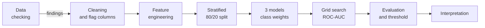
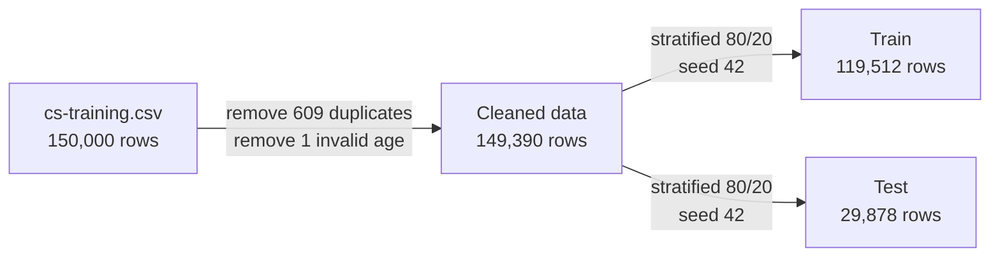

<div align="center">

# Credit Scoring Model
**Predicting loan default with an imbalance-aware machine learning pipeline**

**CodeAlpha Machine Learning Internship, Task 1**

Python | scikit-learn | pandas | Jupyter

</div>

---

## Overview

Before approving a loan, a bank wants to know whether the borrower is likely to fall seriously
behind on payments. This project predicts whether a borrower will be **90+ days late on a payment
within the next 2 years**, using the
[Give Me Some Credit](https://www.kaggle.com/c/GiveMeSomeCredit) dataset (150,000 borrowers).

The main difficulty is class imbalance: only **6.7% of borrowers default**. A model that approves
everyone would score 93.3% accuracy and catch no defaulter at all. For this reason the models are
judged by how many defaulters they catch (**recall**) and how well they rank risk (**ROC-AUC**),
not by accuracy.

The work is a single notebook that moves from raw data to a tuned model. Every cleaning decision
is tied to something found in the data, and every graph answers a specific question.



### Key results

| Aspect | Result |
|---|---|
| Dataset | [Give Me Some Credit](https://www.kaggle.com/c/GiveMeSomeCredit): 150,000 borrowers, 6.7% defaulters |
| Best model | Tuned Random Forest (`max_depth=12`, `min_samples_leaf=50`) |
| ROC-AUC | **0.864**, against 0.827 for the Logistic Regression baseline |
| Recall | **0.77**, catching 1,547 of 2,002 defaulters in the test set |
| Precision | 0.22, the price of catching most defaulters (see [threshold](#74-choosing-a-threshold)) |
| Effect of tuning | Decision Tree ROC-AUC 0.606 → 0.855; Random Forest recall 0.39 → 0.77 |
| Key data finding | Placeholder codes 96/98 mark borrowers who default at 60.4%, against 6.6% for the rest |

---

## Table of contents

1. [Dataset](#1-dataset)
2. [Notebook](#2-notebook)
3. [Data checking and cleaning](#3-data-checking-and-cleaning)
4. [Exploratory analysis](#4-exploratory-analysis)
5. [Feature engineering](#5-feature-engineering)
6. [Modeling](#6-modeling)
7. [Results](#7-results)
8. [Interpretation](#8-interpretation)
9. [Reproducing the results](#9-reproducing-the-results)
10. [Limitations](#10-limitations)
11. [Repository structure](#11-repository-structure)
12. [License and references](#12-license-and-references)

---

## 1. Dataset

| Property | Value |
|---|---|
| Source | [Give Me Some Credit, Kaggle](https://www.kaggle.com/c/GiveMeSomeCredit), file `cs-training.csv` |
| Size | 150,000 borrowers, 10 features and 1 target |
| Target | `SeriousDlqin2yrs` (1 = 90+ days late within 2 years) |
| Class balance | 93.3% non-default, 6.7% default (about 14 to 1) |
| Missing values | `MonthlyIncome` 19.8%, `NumberOfDependents` 2.6% |

| Feature | Meaning |
|---|---|
| `RevolvingUtilizationOfUnsecuredLines` | Credit card balance divided by credit limit |
| `age` | Age of the borrower |
| `NumberOfTime30-59DaysPastDueNotWorse` | Times 30-59 days late |
| `NumberOfTime60-89DaysPastDueNotWorse` | Times 60-89 days late |
| `NumberOfTimes90DaysLate` | Times 90+ days late |
| `DebtRatio` | Monthly debt payments divided by monthly income |
| `MonthlyIncome` | Monthly income |
| `NumberOfOpenCreditLinesAndLoans` | Open loans and credit cards |
| `NumberRealEstateLoansOrLines` | Mortgage and property loans |
| `NumberOfDependents` | People who depend on the borrower's income |

The CSV is not stored in this repository. See [`data/README.md`](data/README.md) for download steps.



Both splits keep the same 6.7% default rate. All three models are trained on the same train set
and scored on the same test set, so the comparison is fair.

---

## 2. Notebook

The whole analysis is in one notebook, [`notebooks/credit_scoring.ipynb`](notebooks/credit_scoring.ipynb).

| # | Section | Description |
|---|---|---|
| 1 | Problem and data understanding | Problem statement, column meanings, first reading of `describe()` |
| 2 | Data checking | Missing values, duplicates, impossible ages, 96/98 codes, DebtRatio |
| 3 | Data cleaning | Each fix based on a finding from section 2 |
| 4 | Feature engineering | Four new columns |
| 5 | EDA | Graphs on target balance, age, late payments and the new columns |
| 6 | Train-test split and scaling | One stratified split shared by all models |
| 7 | Models | Logistic Regression, Decision Tree, Random Forest with metrics and confusion matrices |
| 8 | Comparison and tuning | Results table, `GridSearchCV`, before and after |
| 9 | Threshold and feature importance | Effect of the decision threshold, what drives predictions |
| 10 | Conclusion | Findings, limitations, future work |

---

## 3. Data checking and cleaning

Nothing was cleaned blindly. `describe()` was read first, each odd value was investigated, and
only then was a decision made.

| Problem found | Evidence | Decision |
|---|---|---|
| 609 duplicate rows | 510 of them have no income, so they are mostly thin records that happen to match | Removed (0.4% of the data) |
| Age = 0 | 1 row, impossible for a borrower | Removed |
| Late counts of 96 and 98 | Counts run 0, 1, 2 ... 13, then jump straight to 96 and 98. Being late 98 times in 2 years is impossible | Saved as a flag, then replaced with 0 |
| Missing `MonthlyIncome` (19.8%) | Too many rows to delete | Flag column, then filled with the median |
| Missing `NumberOfDependents` (2.6%) | All of these rows also have missing income | Filled with the median |
| Huge `DebtRatio` values | Median is about 0.3, but over 1,000 when income is missing: the raw debt amount was stored instead of a ratio | `income_missing` flag lets the model separate these rows |
| Utilization above 1 | 3,321 borrowers are over their credit limit, 241 of them above 10 times | `over_limit` flag |

### 3.1 The 96/98 codes are not noise

Borrowers with a 96/98 code default at **54.6%** in the raw data (269 rows), against 6.6% for
everyone else. After duplicates are removed the figure is **60.4%** (225 rows). Replacing the
codes with 0 would have labelled these people as "never late" and thrown away a very strong risk
signal. The exact meaning of the codes is not documented, but the evidence shows they are not real
counts. So a `late_code_flag` column was saved first, and only then were the values cleaned.

| `late_code_flag` | Borrowers | Default rate |
|---|---:|---:|
| 0 (no 96/98 code) | 149,165 | 6.6% |
| 1 (had a 96/98 code) | 225 | **60.4%** |

### 3.2 Why imputation uses the median

Income goes up to 3,008,750 while the median is 5,400. The mean is pulled up by the extreme
values, so missing income and dependents are filled with the median.

---

## 4. Exploratory analysis

The graphs are in the notebook. The key numbers behind each one are summarised below.

### 4.1 Class imbalance

Only 6.7% of borrowers default (10,009 of 149,390), about 1 defaulter for every 14 non-defaulters.
This is why the split is stratified, the models use class weights, and accuracy is not used to
choose a model.

| Class | Borrowers | Share |
|---|---:|---:|
| 0 (no default) | 139,381 | 93.3% |
| 1 (default) | 10,009 | 6.7% |

### 4.2 Past late payments

The default rate rises from 2.8% for borrowers who were never late to 57.2% for borrowers late 5
or more times (the last row means 5 or more).

| Total late payments | Borrowers | Default rate |
|---|---:|---:|
| 0 | 119,308 | 2.8% |
| 1 | 17,231 | 12.2% |
| 2 | 5,942 | 24.1% |
| 3 | 2,884 | 35.0% |
| 4 | 1,595 | 42.6% |
| 5 or more | 2,430 | **57.2%** |

### 4.3 Age

The default rate falls steadily with age, from 11.7% for ages 18-30 to 2.3% for borrowers over 70.

| Age group | Borrowers | Default rate |
|---|---:|---:|
| 18-30 | 10,540 | **11.7%** |
| 31-40 | 24,293 | 9.8% |
| 41-50 | 35,000 | 8.3% |
| 51-60 | 34,729 | 6.2% |
| 61-70 | 27,339 | 3.5% |
| over 70 | 17,489 | 2.3% |

### 4.4 Going over the credit limit

The 3,321 borrowers (2.2%) using more than their limit default at 37.2%, against 6.0% for the rest.

| `over_limit` | Borrowers | Default rate |
|---|---:|---:|
| 0 (within limit) | 146,069 | 6.0% |
| 1 (over limit) | 3,321 | **37.2%** |

### 4.5 Correlation can hide a real pattern

Credit utilization has almost zero correlation with default, because extreme values (up to
50,708) distort the number. Yet `over_limit`, made from the same column, is one of the clearest
signals. Grouped default rates caught what the correlation matrix missed.

| Column | Correlation with default |
|---|---:|
| `total_late` | 0.39 |
| `NumberOfTimes90DaysLate` | 0.31 |
| `NumberOfTime30-59DaysPastDueNotWorse` | 0.27 |
| `NumberOfTime60-89DaysPastDueNotWorse` | 0.27 |
| `over_limit` | 0.18 |
| `age` | −0.12 |
| `RevolvingUtilizationOfUnsecuredLines` | 0.00 |

---

## 5. Feature engineering

| New column | Definition | Reason |
|---|---|---|
| `late_code_flag` | 1 if the borrower had a 96/98 code | Keeps the high-risk signal (60.4% default) |
| `income_missing` | 1 if income was missing | Missing income is not random and explains the huge DebtRatio values |
| `total_late` | Sum of the three late-payment columns | One number for overall payment behaviour |
| `over_limit` | 1 if utilization is above 1 | Separates borrowers who are over their limit |

`total_late` has the highest correlation with default (0.39), higher than any of the three
original late-payment columns alone. `income_missing` turned out to be a weak signal (5.7% default
when missing, against 7.0% when present).

---

## 6. Modeling

### 6.1 Models

| Model | Type | Why included | Preparation |
|---|---|---|---|
| Logistic Regression | Linear | Simple, interpretable baseline | Features scaled with `StandardScaler` |
| Decision Tree | Single tree | Captures non-linear patterns, easy to explain | None needed |
| Random Forest | Ensemble of trees | Usually the strongest on tabular data | None needed |

The scaler is fitted on the training data only and then applied to the test data. Tree models
split on one feature at a time, so they do not need scaling.

### 6.2 Training protocol

| Setting | Value |
|---|---|
| Split | Stratified 80/20, seed 42 |
| Imbalance handling | `class_weight='balanced'` for all three models |
| Random Forest size | 100 trees |
| Tuning | `GridSearchCV`, 3-fold, scored on ROC-AUC |
| Logistic Regression grid | `C` in 0.01, 0.1, 1, 10 |
| Decision Tree grid | `max_depth` in 4, 6, 8, 10 and `min_samples_leaf` in 50, 100, 200 |
| Random Forest grid | `max_depth` in 8, 12 and `min_samples_leaf` in 20, 50 |
| Evaluation | Test split, threshold 0.5 unless stated otherwise |

Tuning is scored on ROC-AUC because accuracy is misleading on this data.

---

## 7. Results

### 7.1 Before tuning

| Model | Accuracy | Precision | Recall | F1 | ROC-AUC |
|---|---:|---:|---:|---:|---:|
| Logistic Regression | 0.860 | 0.269 | **0.636** | 0.379 | 0.827 |
| Decision Tree | 0.901 | 0.262 | 0.266 | 0.264 | 0.606 |
| **Random Forest** | **0.925** | **0.433** | 0.392 | **0.411** | **0.844** |

The untuned Decision Tree grew 50 levels deep with 11,757 leaves and scored 99.97% accuracy on the
training data but only 0.606 ROC-AUC on the test data. It memorised the training data
(overfitting).

### 7.2 After tuning

| Model | Best parameters | Accuracy | Precision | Recall | F1 | ROC-AUC |
|---|---|---:|---:|---:|---:|---:|
| Logistic Regression | `C=0.01` | 0.860 | 0.270 | 0.637 | 0.379 | 0.827 |
| Decision Tree | `max_depth=6`, `min_samples_leaf=200` | 0.772 | 0.199 | **0.797** | 0.319 | 0.855 |
| **Random Forest** | `max_depth=12`, `min_samples_leaf=50` | 0.806 | 0.224 | 0.773 | 0.348 | **0.864** |

| Model | ROC-AUC before | ROC-AUC after |
|---|---:|---:|
| Logistic Regression | 0.827 | 0.827 |
| Decision Tree | 0.606 | 0.855 |
| Random Forest | 0.844 | 0.864 |

**Discussion**

- Limiting tree depth fixed the overfitting. The Decision Tree improved the most, from 0.606 to
  0.855 ROC-AUC.
- Random Forest recall rose from 0.39 to 0.77, with ROC-AUC from 0.844 to 0.864.
- Tuning has a trade-off. The tuned trees catch many more defaulters but also flag more good
  customers, so accuracy and precision dropped. This is acceptable because missing a defaulter
  costs the bank more than a false alarm.
- Logistic Regression did not change. It has few settings to tune, so there was little to gain.
- The tuned Random Forest is only slightly better than the tuned Decision Tree (0.864 against
  0.855), and a single tree is easier to explain.

### 7.3 Confusion matrix of the tuned Random Forest

| | Predicted: no default | Predicted: default |
|---|---:|---:|
| **Actual: no default** | 22,525 | 5,351 |
| **Actual: default** | 455 | 1,547 |

Of 2,002 defaulters in the test set, the model catches **1,547** and misses **455**. It also flags
5,351 good customers as risky. In practice these customers would go to a manual review, not be
rejected automatically.

### 7.4 Choosing a threshold

The default threshold of 0.5 is not fixed. A bank can move it depending on what a missed defaulter
costs compared with reviewing a flagged customer.

| Threshold | Precision | Recall | F1 | People flagged |
|---|---:|---:|---:|---:|
| 0.3 | 0.142 | **0.890** | 0.245 | 12,537 |
| 0.5 | 0.224 | 0.773 | 0.348 | 6,898 |
| 0.7 | **0.342** | 0.587 | **0.432** | 3,441 |

A lower threshold catches more defaulters but flags many more good customers. Choosing the
threshold is a business decision, and it can be changed without retraining the model.

---

## 8. Interpretation

| Feature | Importance (approx.) |
|---|---:|
| `RevolvingUtilizationOfUnsecuredLines` | 0.31 |
| `total_late` | 0.29 |
| `NumberOfTimes90DaysLate` | 0.09 |
| `NumberOfTime30-59DaysPastDueNotWorse` | 0.08 |
| `age` | 0.05 |
| `NumberOfTime60-89DaysPastDueNotWorse` | 0.05 |

- **Credit utilization** (about 0.31) and **`total_late`** (about 0.29) together make up about 60%
  of the model's importance. This agrees with the exploratory analysis.
- Utilization had near-zero correlation with default but is the most important feature, because
  trees can capture non-linear patterns that correlation cannot.
- The engineered `total_late` column is more important than any of the three original
  late-payment columns alone (each below 0.10).
- `over_limit` and `late_code_flag` rank low even though both separate risky borrowers clearly in
  the EDA. `over_limit` is built from utilization, so the model already has that information, and
  `late_code_flag` affects only 225 borrowers (0.15% of the data).
- `income_missing` and `NumberOfDependents` are the least important.

---

## 9. Reproducing the results

Clone or download this repository, then:

```bash
cd CodeAlpha_CreditScoringModel

python -m venv venv
source venv/bin/activate          # Windows: venv\Scripts\activate
pip install -r requirements.txt
```

1. Download `cs-training.csv` from Kaggle and place it in the `data/` folder
   (see [`data/README.md`](data/README.md)).
2. Open `notebooks/credit_scoring.ipynb` in Jupyter or VS Code.
3. Select **Restart & Run All**.

The grid search is the slowest step and takes a few minutes. The notebook reads the data from
`../data/cs-training.csv`, so keep the folder layout. Every split and model uses seed 42, so the
numbers should be very close to those in this README (small differences can appear with other
scikit-learn versions).

---

## 10. Limitations

- Missing values were filled with the median of the whole dataset before the train-test split.
  Strictly, the median should come from the training data only. With 150,000 rows the effect is
  very small.
- Extreme values in utilization (up to 50,708) and `DebtRatio` (up to 329,664) were not capped.
  Tree models are not affected, but Logistic Regression may be.
- There is no customer ID, so some removed duplicates may be different people with identical
  values.
- Precision is low (0.22): more than 3 out of 4 flagged customers do not actually default.
- The thresholds in section 7.4 were compared on the test set for illustration. In production they
  should be chosen on separate validation data, using the bank's real costs.
- All results come from one split and one seed. Small differences, such as 0.864 against 0.855
  ROC-AUC, would need repeated runs to confirm.
- Possible next steps: gradient boosting (XGBoost, LightGBM), SMOTE compared with class weights,
  SHAP explanations, and probability calibration.

---

## 11. Repository structure

```text
CodeAlpha_CreditScoringModel/
├── data/
│   └── README.md               How to download cs-training.csv
├── notebooks/
│   └── credit_scoring.ipynb    Full analysis, run top to bottom
├── LICENSE
├── requirements.txt
├── .gitignore
└── README.md
```

---

## 12. License and references

The code in this repository is released under the [Apache License 2.0](LICENSE). The Give Me Some
Credit dataset is not included and is subject to Kaggle's competition rules.

**References**

1. Credit Fusion, W. Cukierski. *Give Me Some Credit.* Kaggle, 2011.
   [kaggle.com/c/GiveMeSomeCredit](https://www.kaggle.com/c/GiveMeSomeCredit).
2. F. Pedregosa et al. *Scikit-learn: Machine Learning in Python.* Journal of Machine Learning
   Research, 12, 2011.
3. L. Breiman. *Random Forests.* Machine Learning, 45(1), 2001.
4. T. Fawcett. *An Introduction to ROC Analysis.* Pattern Recognition Letters, 27(8), 2006.
